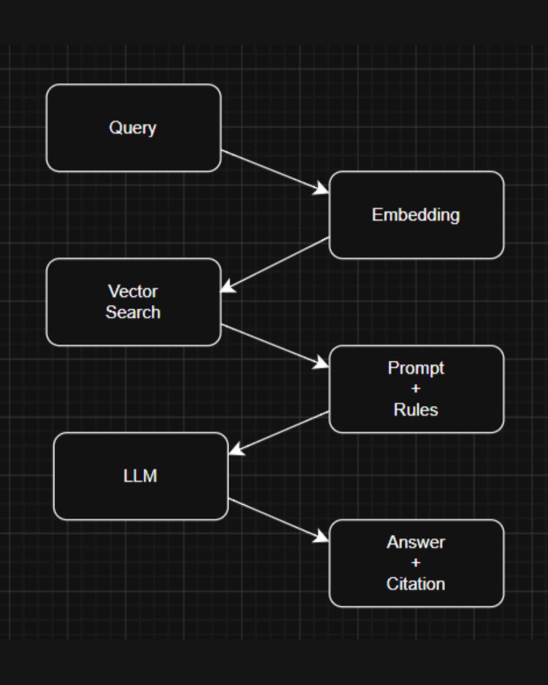

# Part C: Specialized Technology — Retrieval-Augmented Generation (RAG)

## C1 Concepts

### Core Concepts and How They Relate
* **Natural Language Processing (NLP):** A type of artificial intelligence that allows systems to understand, explain, and generate human languages such as Bahasa Melayu and English.
* **Large Language Models (LLMs):** An architecture trained on huge text datasets that produces responses like an actual human. However, LLMs alone rely heavily on the memory learned during training, so they tend to fabricate information when asked about rules they have less information about—especially when regulations are updated.
* **Retrieval-Augmented Generation (RAG):** A hybrid AI architecture that connects an LLM to an external source of data. Rather than generating answers based on pre-trained datasets alone, a RAG pipeline first searches official JPJ documents for related facts and instructs the LLM to generate an answer strictly based on the retrieved passages.

### How It Works Step by Step
1. **Offline Indexing:** Official JPJ FAQ documents are divided into small chunks of paragraphs (*chunking*). Each paragraph is converted into a list of numbers representing its semantic meaning (*vector embeddings*) and stored in a vector database.
2. **Retrieval:** When a user inputs a question, the query is converted into vector embeddings as well. The system compares the question's vector against all stored JPJ paragraphs to detect the top-$k$ closest matches and pull out the most relevant results.
3. **Augmented Generation:** The system combines both the user's question and the retrieved JPJ paragraphs for the LLM to read, generates a reply in Bahasa Melayu or English (matching the user's input language), and attaches the official JPJ FAQ section as proof.

  
   
  <em>Figure 3.1.1: RAG Query Processing Workflow</em>

---

## C2 Frameworks, Models, Methods and Tools

1. **Dense Text Embedding Model — BGE-M3 (Model / Algorithm)**
   * **What it is:** BGE-M3 is a versatile and powerful multilingual embedding model that supports more than 100 working languages and processes inputs at different granularities.
   * **Exact role in MyJPJ:** Converts both user queries and official MyJPJ FAQ documents into dense vectors so the system can semantically match data across both inputs.

2. **Vector Database & Cosine Similarity — FAISS (Method / Tool)**
   * **What it is:** Facebook AI Similarity Search (FAISS) is an open-source library for efficient similarity search and clustering of dense vectors designed to handle large datasets.
   * **Exact role in MyJPJ:** Reduces the time taken for the AI to find the top relevant paragraphs to just a few milliseconds instead of scanning hundreds of pages of JPJ documents every time someone asks a question.

3. **Instruction-Tuned Transformer — Llama 3 (Generative Model)**
   * **What it is:** Llama 3 is an instruction-tuned LLM that excels at understanding language, creating human-quality text, and providing informative responses to user queries.
   * **Exact role in MyJPJ:** Synthesizes the retrieved passages into a professional and polite response in English or Bahasa Melayu based on the user's question and attaches the official FAQ section citation.

---

## C3 Fit to the Problem

### Benefits
* Provides **24/7 bilingual answers** (English and Bahasa Melayu) to motorists without requiring them to navigate messy menus or lengthy documents.
* Allows JPJ administrators to **update policy rules immediately** simply by uploading a new document to the vector database without retraining the model.

### Limitations & Risks
* **Weak Against Wide-Answer Questions:** Because retrieval only grabs the top-$k$ passages (for example, the top 3 results), broad questions that span multiple paragraphs in the JPJ FAQ may leave out some necessary details.
* **Data Privacy Leaks:** Users who accidentally paste private information—such as a 12-digit MyKad number or vehicle registration number—into the chat risk breaching Malaysia's Personal Data Protection Act (PDPA) 2010.

### Alternative Approach Comparison

| Alternative Approach | How It Works | Main Advantage | Why RAG Is Better for MyJPJ |
| :--- | :--- | :--- | :--- |
| **Rule-Based Decision-Tree Chatbot (`If - Else`)** | 1) The chatbot greets the user and provides category buttons: `[1] Driving License` `[2] Summons Payment` `[3] Road Tax`
2) The system detects matching words and moves on to the next scripted button in the decision tree.
3) Once the end of a branch is reached, the bot shows a pre-written text paragraph typed in advance by the developer. | Never hallucinates information and requires very low server runtime cost. | 1) JPJ can simply update the rules by uploading updated JPJ FAQ PDFs into the vector database rather than making manual script rewrites.
2) Instead of fixed menus, RAG generates natural responses in either Bahasa Melayu or English.
3) RAG cites every answer based on the real JPJ FAQ and passes the chat to a live officer if there are unfamiliar cases that the AI cannot answer. |

*Table 3.3.1: Alternative Approach*
